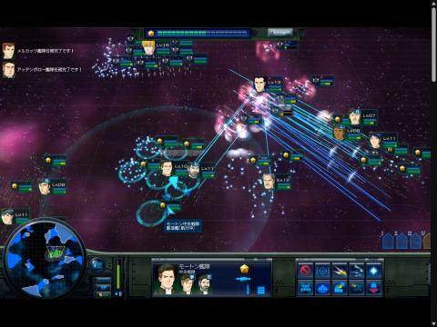
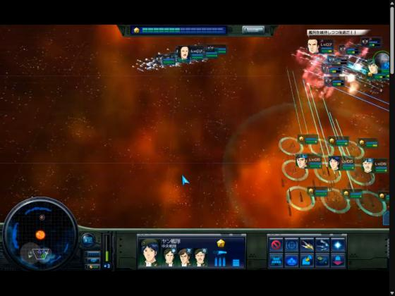
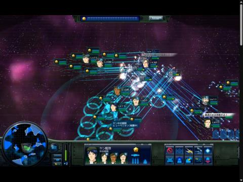
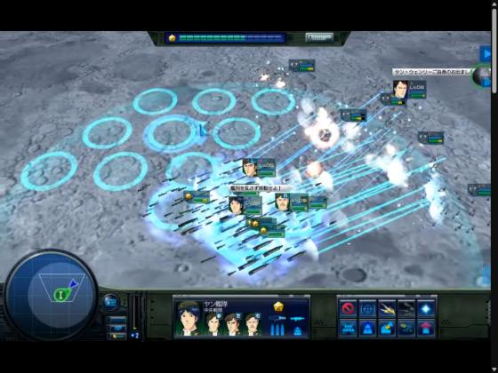
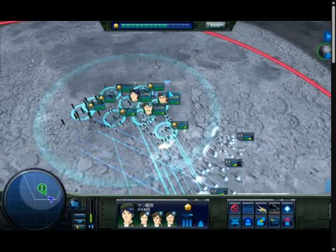
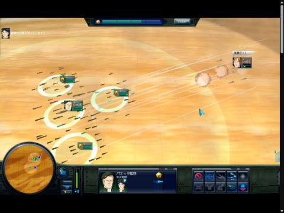
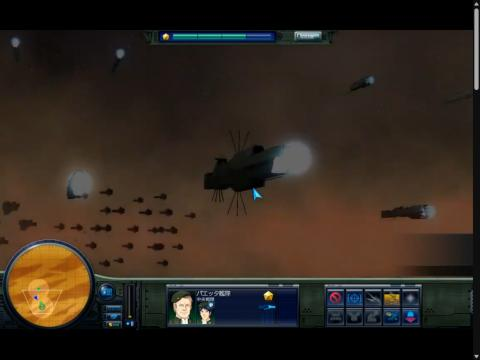
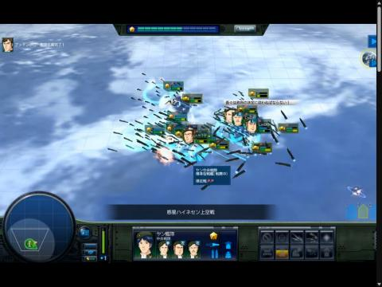

# 영상 참조 통합: 함대 컨트롤·함대 이동·함선 이동 (은하영웅전설7 플레이 6편)

- 날짜: 2026-10-17
- 역할: 컨셉 분석. Godot 코드·시나리오 수치 변경 없음. 새 밸런스 결정·Q번호를 발급하지 않는다.
- 적용 제약: 2026-10-15 사용자 지시(집단 기동·줄/간격·방향 유지 후퇴만 표현, 흔들림·난수 위치 편차·격침 뒤 자동 빈자리 메우기 제거)와 Q73 함대 단일 계층이 이 문서의 모든 제안보다 우선한다. 실행 계획은 `PLAN-REFERENCE-MOTION-ONLY.md`, 결정 보충은 `BATTLE_DECISIONS.md` §V.
- 전장 지형·미니맵 지형 분석(T1~T4)과 구현 인수 조건(A/B/C)은 `VIDEO-IKHU38xL1E-FLEET-TERRAIN.md` §4~§8에 그대로 둔다. 이 문서는 함대 조작·움직임만 통합한다.

## 0. 결론 요약

| 항목 | 근거 영상 | 판정 | 우리 게임 |
|---|---|---|---|
| 함대 단위로 진형 형태를 유지하며 이동 | 6편 전부 | 확정 | 유지(F1·F2) |
| 진형 유지 후퇴, 함수·사격 방향은 적 쪽 | 플레이3·6·12·14 | 확정 | 유지(F5·M4) |
| 이동 명령 지점에 마커 표시, 함대 위치와 분리 | 플레이3·6·12·8 | 확정 | 유지 |
| 목적지에 도착 진형(빈 슬롯 링) 미리보기 | 플레이6·12 | 확인 | 채택 후보 M1 |
| 슬롯(링)마다 함선 소집단이 고정되어 함께 이동 | 플레이6·12·1·8 | 강한 추론 | 채택 후보 M2 |
| 소집단 안 함선은 엇갈린 줄·같은 간격·같은 방향 | 플레이3·1·14 | 확인 | 채택 후보 M8 |
| 진형별 슬롯 배열 형태가 다름 | 플레이6·12·14 | 확인 | 채택 후보 M6 |
| 이동 중 진행 방향으로 늘어나고 정지하면 모임 | 플레이12·1 | 추론 | 채택 후보 M7 |
| 링·지휘 범위 원은 선택한 함대에만 표시 | 플레이1·12 | 확인 | 채택 후보 M9 |
| 선택 함대 옆 "함대명 / 진형(상태) / 특성" 표시 | 플레이6·12·8·14 | 확인 | 채택 후보 M5 |
| 명령 완료 알림 로그 | 플레이14 | 확인 | 채택 후보 M10 |
| 근접전에서 함수 방향이 흩어짐 | 플레이8 | 관찰 1회 | 보류 |
| 하위 전대(중앙·좌익·우익) 분리 조작 | 플레이1·3·8 | 확인 | Q73에 따라 제외 |
| "대열 유지 / 최단 거리" 이동 옵션 | 플레이6 대사 | 미확인 | 보류 |
| 개별 회피·충돌 회피·격침 후 슬롯 메우기 | 없음 | 증거 없음 | 10-15 지시로 제외 |

## 1. 근거와 분석 한계

| 편 | 원본 | 길이 | 전장 | 확인 표본 |
|---|---|---|---|---|
| 플레이1 | https://www.youtube.com/watch?v=JzDUgHrVivQ | 23:55 | 행성 레그니처 상공 | 18장 |
| 플레이3 | https://www.youtube.com/watch?v=_IKHU38xL1E | 17:43 | 아스타테 회전 | 45장 + 연속 16장 |
| 플레이6 | https://www.youtube.com/watch?v=q9AyxvhML04 | 25:29 | 성운·달 표면 | 31장 + 확대 4장 |
| 플레이8 | https://www.youtube.com/watch?v=DHTK6i7ZR-8 | 23:14 | 행성 하이네센 상공 | 8장 + 확대 2장 |
| 플레이12 | https://www.youtube.com/watch?v=b-7crU8CS18 | 15:11 | 성간 공간 | 18장 + 확대 1장 |
| 플레이14 | https://www.youtube.com/watch?v=HGh5vL6y79I | 26:40 | 성운·소행성대 | 9장 + 확대 2장 |

- 업로더는 모두 같고(프라우엔), 제목의 편수는 업로더 표기다. 게임 버전은 따로 검증하지 않았다.
- 플레이3은 watch 0.3.2 local 엔진으로 추출했다. 나머지 5편은 이 PC에서 yt-dlp 네트워크가 막혀(WinError 10013) 내장 브라우저에서 재생 위치를 옮겨 가며 캡처했다. 원본 해상도는 1152×720이다.
- 6편 모두 자막이 없고, 음성은 분석하지 않았다. 화면의 일본어 상태 문구·대사 말풍선·로그만 참고했다.
- 컷인·로딩·암전·대화 장면은 기동 근거에서 제외했다.
- 플레이8·14는 표본 간격이 2~2.5분으로 성기다. 이 두 편에서는 앞 영상의 결론을 확인하는 정도로만 썼다.
- 가속도, 선회 속도, 함선별 경로 알고리즘, 버튼별 정확한 기능, 판정 수치는 확인할 수 없다.
- 이하 **관찰**은 화면 사실, **추론**은 해석, **제안**은 우리 게임용이다.

## 2. 함대 컨트롤

### 2.1 조작 단위와 계층

- **관찰:** 화면에서 지휘관 초상 + 레벨 + 체력·사기 막대가 함선 덩어리마다 붙는다. 개별 함선보다 "누가, 어디, 어떤 상태"가 먼저 읽힌다(플레이3 03:10, 플레이6 03:00~06:00).
- **관찰:** 하단 패널에 선택 단위의 이름과 초상이 나온다.
  - 함대 전체나 중앙 전대를 선택하면 지휘관·막료 초상이 2~4명 나온다.
  - 하위 전대만 선택하면 「右」「左」 표식과 함께 초상 1명만 나온다.
  - 사례: 플레이1 09:00 「파에타 함대 / 애튼버러 우익 전대」, 플레이8 20:00 「양 함대 / 파트리체프 좌익 전대」.
- **관찰:** 하위 전대는 본대와 떨어져 따로 이동한다(플레이1 09:00, 플레이3 02:36~02:44).
- **정리:** 원작은 "함대 → 중앙·좌익·우익 전대" 계층이 있다.
- **우리 게임:** Q73(함대 단일 계층)을 유지한다. 전대 선택이나 분리 조작은 들여오지 않는다. 함대 내부의 링 묶음이 좌·중·우로 나뉘어 보이는 표현만 참고한다.

### 2.2 명령과 피드백

| 요소 | 관찰 | 근거 |
|---|---|---|
| 이동 마커 | 지정 지점에 화살표 달린 청록 링이 찍힌다. 함대는 아직 원래 자리에 있다. | 플레이6 02:00, 플레이12 03:45·11:40, 플레이8 03:00 |
| 지휘 범위 원 | 선택 함대 주변에 큰 반투명 원(타원)이 깔린다. 함대와 함께 움직인다. | 6편 공통 |
| 상태 박스 | 선택 함대 옆에 3줄이 표시된다. 「함대명 / 진형명 또는 함종(상태) / 특성」. 예: 회전진(전투 중), 방추진(항행 중), 미사일함, 접근전. | 플레이6 06:00·23:20, 플레이12 05:30, 플레이8 03:00·08:00 |
| 대사 말풍선 | 명령에 맞는 지휘관 대사가 뜬다(돌격, 후퇴, 진형 유지 등). | 6편 공통 |
| 좌상단 로그 | 피격 경보(미사일 공격 받음)와 「○○ 함대 임무 완료」 알림이 쌓인다. | 플레이12 03:45, 플레이14 15:00·19:00 |
| 하단 패널 | 왼쪽: 원형 레이더 미니맵과 카메라 시야 사다리꼴. 가운데: 선택 단위의 초상. 오른쪽: 명령 버튼 5×2. | 6편 공통 |
| 특수 명령 | 컷인과 효과 설명 한 줄이 나오고, 전투 흐름이 잠시 끊긴다. | 플레이6 11:00·12:55·18:00, 플레이1 10:30 |
| 전투 전 브리핑 | 행성 지도, 전투명, 게임 시간(30:00), 승리 조건 2줄. | 플레이1 01:30 |
| 전투명 배너 | 화면 하단에 전투명이 잠깐 표시된다. | 플레이8 17:00 |

**정리:** 조작 흐름은 6편 모두 같다. "단위 선택 → 하단 패널 확인 → 지점·방향·진형 지정 → 마커 표시 → 함대가 따라감 → 완료 알림" 순이다. 여러 함대를 번갈아 선택해 서로 다른 지점에 배치하는 조작이 반복된다(플레이12, 플레이14).

## 3. 함대 이동

### 3.1 이동과 후퇴

| 시점 | 관찰 |
|---|---|
| 플레이3 03:30~04:00 | 전진·좌선회 문구가 보인다. 화면 중심과 미니맵 윤곽의 위치가 달라, 카메라 이동과 함대 이동이 별개다. |
| 플레이3 06:40~06:48, 플레이6 09:00 | 진형을 유지하며 후퇴한다는 문구나 대사가 나온다. 링 묶음은 격자 형태 그대로이고, 적을 향한 사격선이 이어진다. |
| 플레이6 16:00~17:00 | "그대로의 대열로 후퇴" 계열 대사. 함수는 적 쪽, 링 배열 유지. |
| 플레이6 07:00~08:00, 플레이12 10:30 | 링 묶음 전체와 지휘 범위 원이 형태를 유지한 채 이동하며 사격한다. |
| 플레이3 11:31, 플레이6 21:00, 플레이14 11:00 | 아군 함대들이 서로 떨어진 위치에서 각각 교전한다. 측면 위치가 남는다. 함대끼리 화면상 겹치기도 한다. |

- **정리:**
  - 함대 이동은 함대 중심과 진형이 함께 움직이는 것이다.
  - 이동 방향과 함수·사격 방향은 분리된다.
  - 함대끼리 겹치는 것은 정상이다(우리 게임의 결정과 일치).
- **주의:** 화면에서 후퇴 중 사격이 보인다고 해서 모든 무기의 후퇴 사격이 허용된다는 증명은 아니다. 일반 후방 이동과 사기 붕괴로 인한 강제 퇴각도 서로 다른 상태다.

### 3.2 진형과 슬롯 배열 형태

| 배열 | 상황 | 근거 |
|---|---|---|
| 사선(계단식) | 전투 시작 배치. 링마다 사격선이 평행하게 뻗는다. | 플레이12 01:00·03:45, 플레이1 12:00 |
| 덩어리(3×2, 3×4) | 정면 교전, 도착 직후 | 플레이12 04:30, 플레이6 12:50 |
| 호·초승달 | 적의 긴 종대나 덩어리를 감싼다. 링 15개 안팎. | 플레이12 06:30·12:40, 플레이14 07:30 |
| 가로 한 줄 | 사격하며 이동 | 플레이12 10:30 |
| 세로 한 줄 | 이동 마커를 찍은 직후 | 플레이12 11:40 |
| 2열 세로 덩어리 | 근접 교전 | 플레이8 08:00 |
| 굽은 사슬 | 배열을 바꾸는 도중. 링 간격이 고르지 않다. | 플레이12 13:50 |

- 상태 박스의 진형명은 이동용(방추진·항행 중)과 전투용(회전진·전투 중)이 구분된다(플레이6).
- 적 함대도 긴 종대나 덩어리 형태를 보인다. 진형이 양측 모두의 시각 언어다.

## 4. 함대 안 각 전함의 이동

### 4.1 목적지 슬롯 미리보기와 슬롯 대응 이동

| 시점 | 관찰 |
|---|---|
| 플레이6 12:00 | 링들이 세로로 길게 늘어선 상태로 이동 중이다. 각 링 아래의 함선들은 같은 방향으로 줄지어 있다. |
| 플레이6 12:50 / 13:00 | 목적지에 빈 청록 링 격자(약 3×4)가 먼저 나타난다. 함선들은 그 앞쪽에서 사격하며 링을 향해 이동 중이다. 대사: 대열을 흐트러뜨리지 말고 이동하라. |
| 플레이6 13:06 | 링 격자 안으로 함선들이 들어오기 시작한다. 함선은 거의 같은 방향을 향하고, 엔진 궤적이 평행하다. |
| 플레이6 13:15 | 다른 지휘관 대사: 각 함, 최단 거리로 이동하라. |
| 플레이6 13:30 | 링 묶음이 원래 격자 간격으로 정돈된다. 함선 무리가 각자 링 아래에 다시 모였다. |
| 플레이12 11:30 | 빈 링 격자가 함대 본체와 떨어진 곳에 있다. 같은 미리보기다. |
| 플레이12 13:50 | 링 배열을 바꾸는 도중에도 함선 무리가 각자 자기 링에 붙어 이동한다. 다른 링과 섞이지 않는다. |
| 플레이8 08:00 | 앞쪽 링 근처에 함선이 몰려 교전하고, 뒤쪽 링 몇 개는 비어 있다. 함선 무리가 목표 링에 아직 도착하지 않은 상태로 추정된다. |

- **관찰 요약:**
  - 이동 명령 직후 목적지에 도착 진형(슬롯 링)이 먼저 그려진다.
  - 함선은 동시에 출발하고 평행한 진로로 이동한다.
  - 출발 대기 행렬이나 함선별 흔들림은 보이지 않는다.
- **추론:**
  - "자기 링 → 목적지의 같은 링"으로 대응해 이동한다.
  - 대사 두 종류(대열 유지 / 최단 거리)는 이동 방식 옵션일 수 있지만, 버튼과의 대응은 확인하지 못했다.
- **미확인:** 앞 배 추종인지 슬롯 추종인지, 회피용 힘이 있는지, 내측·외측 속도를 다르게 계산하는지는 표본으로 결정할 수 없다. 플레이3의 0.5초 간격 연속 16장에서도 개별 자율 경로탐색이나 회피 AI는 확인되지 않았다.

### 4.2 소집단 안 함선 배열

- **관찰:**
  - 링 하나에 함선 10~20척이 붙는다. 링은 무리의 앞쪽 중심에 놓이고, 함선은 링 둘레와 뒤쪽을 채운다(플레이1 12:00).
  - 근접 시점에서 소형 함선들이 일정한 간격으로 엇갈린 몇 줄을 이루고 모두 평행하게 같은 방향을 향한다. 대형 함선은 그 위쪽에서 따로 움직인다(플레이1 16:40).
  - 플레이3 08:30·15:34에서도 간격을 가진 편대 형태가 유지된다.
- **예외:**
  - 플레이8 17:00의 근접 난전에서는 함선들의 함수 방향이 제각각 흩어진다.
  - 이 장면은 표본 1장뿐이고 선회 중인 순간일 수 있어 규칙으로 삼지 않는다.

### 4.3 이동 중 형태와 선택 표시

- 이동 중인 함대는 함선들이 진행 방향으로 길게 늘어진다. 정지하거나 교전하면 링 둘레에 모인다(플레이12 11:30, 플레이1 06:30~07:30).
- 선택하지 않은 함대는 링 없이 함선 점들의 무리로만 보인다. 링과 지휘 범위 원은 선택한 함대에만 그려진다(플레이1, 플레이12).

## 5. 우리 게임 적용 규칙

### 5.1 기존 기본 원칙 (플레이3 분석 F1~F5, 유지)

- **F1. 함대 명령과 함선 표현을 분리한다.**
  - 명령·이동·사격·탐지·피해·지형 판정은 함대 코어가 맡는다.
  - 개별 함선은 "함대 중심 + 함대 방향으로 회전한 자기 슬롯"을 따라간다(`fleet_renderer.gd` 슬롯 패턴 재사용).
  - 화면 좌표를 코어 판정에 되먹임하지 않는다. 렌더링이 전투 난수나 재생 결과를 바꾸면 안 된다.
- **F2. 동시에 출발하고, 점진적으로 선회하고, 도착 후 정돈한다.**
  - 행렬식으로 늦게 출발하는 함선은 없다.
  - 함수는 이동 벡터를 따라 연속적으로 돌고, 정지 근처에서 떨리지 않는다.
  - 선회 때 슬롯은 함대 중심 주위로 회전한다.
  - 함대 도착 시간은 화면 보정 때문에 바뀌지 않는다.
- **F3. 진형 전환은 현재 위치에서 이어진다.**
  - 목표 진형은 명령 즉시 정해지고, 전환 시간은 코어 값(5초, 팔진 2.5초)을 따른다.
  - 전환 도중에 재명령하면 당시 화면 위치에서 이어 간다. 순간이동은 없다.
- **F4. 근접 회피: 적용 제외** (2026-10-15 지시).
- **F5. 후퇴·평행 이동은 함수 방향과 이동 방향을 분리해 보인다.**
  - 평행 이동 속도는 전진의 60%다.
  - 실제 사격 여부는 코어 판정을 따른다.
  - 강제 퇴각과 일반 후방 이동은 다른 상태로 표시한다.

### 5.2 추가 제안 (M1~M10)

| # | 제안 | 근거 | 비고 |
|---|---|---|---|
| M1 | 이동 명령 시 목적지에 도착 진형 미리보기(슬롯 윤곽)를 그리고, 도착하면 지운다. | 플레이6·12 | 표현 전용. 태블릿 터치 명령 확인에도 유용하다. |
| M2 | 함선 소집단은 자기 슬롯 번호를 유지하고, 목적지의 같은 번호 슬롯으로 간다. 슬롯 재배정·자동 빈자리 메우기는 하지 않는다. | 플레이6·12·8 | 10-15 지시와 일치. |
| M3 | 모든 함선이 동시에 출발하고, 평행 진로로 가고, 도착 후 간격을 정돈한다. 흔들림·난수 편차는 없다. | 플레이6·1 | F2의 근거 보강. |
| M4 | 후퇴할 때 진형·함수 방향은 유지하고 이동 방향만 바꾼다. | 플레이3·6·12 | F5와 동일. |
| M5 | 선택 함대 옆에 "진형 / 상태(이동·전투)"를 한 줄로 표시한다. | 플레이6·12·8·14 | 기존 UI 결정이 우선한다. |
| M6 | 진형마다 슬롯 배열 형태를 뚜렷이 다르게 둔다(사선·호·줄·덩어리). 배열만 보고 진형을 알 수 있어야 한다. | 플레이12·14 | 진형 목록·수치는 본편 data를 따른다. 형태 대응은 구현 세션이 정한다. |
| M7 | 이동 중에는 슬롯 간격을 진행 방향으로 늘이고, 도착하면 원래 간격으로 되돌린다. | 플레이12·1 | 결정적 보간. 원작 동작은 추론 수준이다. |
| M8 | 슬롯 하나에 함선 소집단을 엇갈린 줄로 놓고, 같은 방향·같은 간격을 유지한다. | 플레이1·3 | 기존 슬롯 패턴 안에서 소집단 배열만 정한다. |
| M9 | 슬롯 링·지휘 범위 원은 선택한 함대에만 그린다. 선택하지 않은 함대는 함선 형태만 보인다. | 플레이1·12 | 태블릿 가독성을 확인해야 한다. |
| M10 | 이동·진형 전환 명령이 끝나면 "○○ 함대 완료"를 짧게 알린다. | 플레이14 | 기존 로그·토스트 UI를 재사용한다. 새 UI 계층은 만들지 않는다. |

### 5.3 보류·제외

| 항목 | 처리 | 이유 |
|---|---|---|
| "대열 유지 / 최단 거리" 이동 옵션 분리 | 보류 | 근거가 대사뿐이고 버튼 대응이 미확인이다. |
| 진형 전환 중 링 간격이 고르지 않은 것 | 별도 연출 없음 | 단순 보간의 결과일 가능성이 있다. |
| 근접 난전에서 흩어진 함수 방향 | 보류 | 표본 1장. 흔들림 제거 지시와 충돌할 수 있다. |
| 하위 전대 선택·분리 조작 | 제외 | Q73 |
| 특수 공격 컷인 | 제외 | 이번 범위 밖 |
| 개별 회피·충돌 회피·격침 후 슬롯 메우기 | 제외 | 증거 없음, 10-15 지시 |
| 전투 전 브리핑·전투명 배너 | 기록만 | 적벽 UI 결정을 따른다. |

### 5.4 확정 규칙과의 경계

| 확정 조건 | 처리 |
|---|---|
| Q73 함대 단일 계층 | 전대 계층을 넣지 않는다. 좌·중·우 링 묶음은 내부 표현으로만 쓴다. |
| Q60 그룹은 가장 느린 속도로, 중심 상대 위치 유지 | 함대 내부 움직임은 그룹 중심 오프셋을 보존하는 범위 안에서 표현한다. |
| Q68 유지 거리 170, 그룹 정지 규칙 | 화면 함선이 정지 규칙을 무시하지 않는다. |
| R1 아군 함대 겹침 허용 | 코어 반발·길막을 추가하지 않는다. |
| S-2 진형 목표 즉시 지정, 코어 시간 동안 이동 | M1·M2·M7은 이 시간 안의 표현이다. |
| Q72 회피 명중 보정·화면 흔들림 | 슬롯 이동을 새 보너스로 해석하지 않는다. 흔들림은 10-15 지시로 제거한다. |

코어 기본값: 선회 9°/초, 평행 이동 60%, 경유+목적지 최대 5개(`combat_m3.json:584`, `battle_sim.gd:671`). 영상에서 재측정한 값으로 덮지 않는다.

## 6. 대표 프레임

| 폴더 | 파일 |
|---|---|
| `reference-assets/IKHU38xL1E/` | fleet-08m30s, minimap-03m10s |
| `reference-assets/q9AyxvhML04/` | rotate-formation-06m00s, retreat-09m00s, slot-preview-12m50s, arrived-13m30s, slot-preview-14m00s |
| `reference-assets/b-7crU8CS18/` | echelon-03m45s, arc-06m30s, slot-preview-11m30s, column-marker-11m40s, reform-13m50s |
| `reference-assets/JzDUgHrVivQ/` | briefing-01m30s, split-07m30s, wing-select-09m00s, rings-12m00s, ship-rows-16m40s |
| `reference-assets/DHTK6i7ZR-8/` | move-marker-03m00s, rings-ahead-08m00s, melee-headings-17m00s, left-wing-20m00s |
| `reference-assets/HGh5vL6y79I/` | crescent-07m30s, order-done-log-19m00s, asteroids-23m00s |

## 7. HTML PoC

[`docs/poc/fleet-motion-ref/index.html`](../poc/fleet-motion-ref/index.html). 단일 파일이며, 기존 PoC·게임 코드·에셋을 전혀 쓰지 않고 새로 작성했다. 아래는 2026-10-17 마지막 상태다.

### 7.1 편성

- 아군은 유비·관우·장비·조운·마초·황충, 적은 조조와 위 오자양장(장료·악진·우금·장합·서황)이다. 양쪽 모두 함대 6개다.
- 함대 하나는 함선 100척을 한 진형으로 직접 배치한다. 소집단(링)과 하위 전대는 없다.
  - 사용자 지시로 「함대를 소함대로 나누기」와 「함대당 소집단 6개」를 모두 없앴다.
  - 그래서 M2·M8의 "슬롯 = 소집단" 대신 "함선 k = 진형의 k번 자리"로 바꿔 시험한다.
- 여러 함대를 묶어 함께 지휘하는 「묶음」은 남겼다. 묶음 안에 묶음을 넣을 수도 있다.
  - Q60 그룹 이동과 같은 성격이고, 함대를 나누는 기능이 아니다.

### 7.2 동작

- **진형:** 덩어리, 가로줄, 세로줄, 사선, 호. 줄은 1/4칸씩 엇갈린다.
  - 전환에는 5초가 걸리고, 함선마다 자기 번호의 새 자리로 이어서 이동한다.
  - 자리 재배정이나 빈자리 메우기는 없다.
- **이동:** 도착 진형 미리보기는 목표 진형의 함선 자리를 점으로 보여 준다. 방향 화살표가 붙는다.
  - 이동 중에는 함수 축 방향으로 간격이 늘어난다.
  - 선택한 함대에만 윤곽 원을 그린다.
- **후퇴:** 함수 방향을 유지하고 속도는 60%다.
- **가시 범위와 정찰함:**
  - 가시 범위는 함대 진형에서 가장 바깥에 있는 함선들(볼록 껍질)을 기준으로 250만큼 넓힌 영역이다. 중심 기준 원이 아니라서, 가로줄처럼 넓게 펼친 진형은 옆으로 더 멀리 본다.
  - 함대 안에 정찰함이 살아 있고 레이더 거리(450)가 가시 거리보다 크면, 같은 방식(바깥 함선 기준)으로 450만큼 넓힌 영역을 쓴다. 정찰함이 모두 격침되면 가시 범위로 돌아간다.
  - 적 함선이 하나라도 이 영역 안에 들어오면 그 적 함대가 보인다고 본다.
  - 정찰함 배치: 아군은 조운·마초 함대에 2척씩, 적은 장료 2척·서황 1척. 함대 안에 고르게 섞여 있고 흰 마름모로 그린다.
  - 선택한 함대의 가시 범위를 옅게 칠한다(레이더 범위는 청록). 상태 박스에 정찰함 수와 가시·레이더 거리를 보여 준다.
  - 사격도 보이는 적에게만 한다. 사거리(420) 안이어도 안 보이면 쏘지 않는다.
  - 적 AI가 아군을 찾아 다가가는 거리(1100)와 안개(안 보이는 적 숨기기)는 이번 범위가 아니어서 그대로 두었다.- **평소 이동과 접적 이동:**
  - 평소(가시 범위 안에 적이 없을 때): 이동 방향으로 선회한 뒤 이동하고, 도착하면 지정 방향으로 돌아선다. 아래 제자리 반전도 이 경우에 적용된다.
  - 접적(가시 범위 안에 적 함대가 보일 때):
    - 각 함선은 가장 가까운 적 함대 중심을 향한다.
    - 함대는 진형 배치를 돌리지 않고 평행 이동만 한다. 도착해도 진형 방향을 다시 맞추지 않는다.
    - 속도는 적 쪽 ±45° 안으로 갈 때 100%, 옆이나 뒤로 갈 때 60%다.
    - 사격각과 측후방 판정은 함선이 실제로 바라보는 방향(적 쪽)을 기준으로 한다.
    - 묶음은 구성 함대 중 하나라도 접적이면 배치를 돌리지 않고 평행 이동한다.
    - 멈춰 있을 때도 적이 보이면 함선들은 계속 적을 바라본다(2026-10-17 사용자 확정).
  - 선택한 함대에는 가시 범위와 조준 대상 연결선이 표시된다.- **제자리 반전(기본 켜짐, 하단 「제자리 반전」으로 끔):**
  - 이동 방향이나 도착 방향이 지금 함수에서 90° 넘게 벗어나면, 함대 전체를 빙 돌리지 않는다.
  - 기준 방향을 한 번에 180° 뒤집고, 진형 자리도 점대칭으로 뒤집는다. 그래서 함선 위치는 그대로다.
  - 함선들은 자리를 지킨 채 1초 동안 제자리에서 180° 돌아서고, 그동안 함대는 멈춘다. 남은 90° 이하의 방향 차이는 기존처럼 선회한다.
  - 진형 모양도 위치를 지킨 채 뒤집힌다. 예를 들어 호 진형은 뒤집힌 뒤 오목한 쪽이 뒤를 향한다. 다시 앞을 향하게 하려면 진형을 다시 지정한다.
  - 묶음도 같은 기준으로 뒤집혀, 묶음이 180° 돌 때 함대들이 서로 자리를 바꾸지 않는다.
- **함대 진형과 묶음 진형:**
  - 함대를 선택하고 진형을 고르면 그 함대만 바뀐다. 묶음 안의 함대도 묶음에서 빠지지 않고 진형만 바꿀 수 있다.
  - 묶음을 선택하고 진형을 고르면 두 가지가 함께 바뀐다.
    - 묶음 안 함대들의 배치가 그 진형 모양(덩어리·가로줄·세로줄·사선·호)으로 재배치된다.
    - 안의 모든 함대 진형도 같은 진형으로 맞춰진다. 안쪽 묶음이 있으면 거기까지 같은 진형이 적용된다.
  - 재배치 간격은 구성 함대가 새 진형일 때의 크기에 맞춘다. 함대 사이 여유는 30이다.
  - 자리는 현재 좌우 순서(세로줄이면 앞뒤 순서)대로 정해서 함대끼리 엇갈리지 않는다.
  - 재배치는 묶음 중심 그대로, 지금 함수 방향 기준으로 이루어진다.
  - 한계: 함선 100척 함대 여러 개를 가로줄·세로줄로 묶으면 전장(1600×900)보다 길어질 수 있다. 이때 끝 함대는 전장 경계에서 멈춘다.
- **묶음:**
  - 묶을 때 잡아 둔 상대 위치를 유지한 채 함께 움직인다. 도착 방향으로 배치 전체를 돌리고, 거리에 따라 속도를 나눠 동시에 도착한다.
  - 묶음 안의 함대에 따로 명령하면 그 함대만 빠진다. 남은 구성원이 1개가 되면 묶음은 자동으로 풀린다.
- **교전:** 양쪽 모두 기본으로 꺼져 있다. 하단 「교전」 버튼으로 켠다.
  - 켜면 사거리 420 안에서, 함수 좌우 70° 안의 가장 가까운 적에게 사격한다.
  - 적의 측면·후방(100° 밖)을 치면 피해가 ×1.5다.
  - 공격자에게 가장 가까운 함선부터 격침되고, 그 자리는 비워 둔다.
  - 사격 대상을 모두 정한 뒤 피해를 한꺼번에 적용한다.
  - 적 AI는 교전이 꺼져 있어도 아군 쪽으로 다가온다.

### 7.3 조작(마우스 중심, 버튼 없음)

- 왼쪽 클릭: 선택(묶음이면 묶음 전체). 더블클릭: 그 함대만. Shift·Ctrl+클릭: 추가·빼기. 빈 곳 클릭: 해제.
- 왼쪽 끌기: 상자 선택. 묶음이 통째로 들어가면 묶음, 일부만 들어가면 그 함대를 고른다.
- 오른쪽 클릭: 이동. 오른쪽 끌기: 이동 + 도착 방향.
- 아군 위 오른쪽 클릭: 메뉴. 진형 5종(묶음을 선택했으면 「묶음 진형」), 후퇴, 정지, 선택 묶기, 묶음 해제, 그 함대만 선택.
- 터치: 탭은 선택·이동. 끌기는 방향 이동(선택이 없거나 아군에서 시작하면 상자 선택). 길게 누르면 메뉴.
- 하단에는 재시작, 교전, 표시 옵션(도착 미리보기, 이동 늘림, 윤곽 항상, 도움말)만 있다. 키보드 단축키는 보조로 남겼다.

### 7.4 한계와 확인

- **없는 것:** 사기, 지형, 미니맵, 보급, 함종 차이.
- **수치:** 속도, 선회(36°/초), 전환 5초, 함선 간격 10, 사거리·사격각·피해(함선당 초당 0.12)·배율은 화면 확인용 PoC 값이다. 코어 정본이 아니다.
- **자체 검사:** `index.html?test`로 열거나 콘솔에서 `selfTest()`를 실행한다. 54항목 PASS(2026-10-17 내장 브라우저).
  - 기동 8항목: 전환 시간, 후퇴 중 함수 유지, 도착 방향 정렬, 함선 자리 고정, 정지 후 같은 방향, 결정성.
  - 교전 5항목: 정면 대치 동일 손실, 사격각 밖 무사격, 후방 피격 손실 증가, 격침 뒤 자리 유지, 교전 결정성.
  - 묶음 10항목: 평행·회전 이동 시 상대 위치 유지, 동시 도착, 개별 명령 이탈, 자동 해제, 중첩 묶음 이동, 안쪽 이탈 시 바깥 유지, 바깥·안쪽 묶음 해제.
  - 제자리 반전 8항목: 기준 방향 즉시 반전, 반전 중 위치 유지, 제자리 선회 중, 1초 뒤 180° 완료, 반전 뒤 전진 도착, 제자리 방향 지정 반전, 스위치를 끄면 기존 선회, 묶음 반전 시 자리 유지.
  - 접적 7항목: 진형 방향 유지, 옆걸음 60%, 함선이 적을 향함, 도착 후 방향 재정렬 없음, 접적 중 뒤쪽 명령도 반전 없음, 적이 멀면 기존 선회, 접적 묶음 평행 이동.
  - 가시 범위 5항목: 바깥 함선 기준 250(간격 240 보임·260 안 보임), 진형 끝 기준(가로줄은 옆으로 멀리), 정찰함 레이더 450 적용, 정찰함 격침 시 복귀, 안 보이면 사격 안 함.
  - 진형 6항목: 묶음 진형 → 구성 함대 진형 동기화, 가로줄 재배치, 좌우 순서 유지, 묶음 안 단일 함대 진형 변경(묶음 유지), 중첩 묶음 진형 동기화, 중첩 배치 도착.
  - 상자 선택 4항목.
  - 초기 배치 1항목: 아군 6·적 6, 함대당 100척, 소집단·초기 묶음 없음.
- **화면 확인:**
  - 교전이 꺼진 상태에서 손실이 없는 것을 확인했다. 켠 뒤에는 사격과 격침이 일어났다(직전 72척 구성에서 확인).
  - 100척 구성에서는 호·사선 진형 전환과 이동을 화면으로 확인했고, 콘솔 오류는 없었다.
  - 마우스 조작은 상자 선택만 실제 마우스로 해 봤다. 오른쪽 클릭 메뉴, 묶기, 오른쪽 끌기 이동, 더블클릭은 페이지에서 만든 포인터 이벤트로 확인했다.
    - 브라우저 도구의 오른쪽 클릭은 끝에 왼쪽 클릭 2번이 더 붙어 들어와 메뉴가 바로 닫혔다.
  - 실제 마우스·터치 기기로는 확인하지 않았다.
## 8. 인계

- 이 문서는 플레이6·12·1 개별 문서(2026-10-17 작성)를 대체한다. 그 세 파일은 삭제했다.
- 플레이3 문서는 지형·미니맵·구현 인수 조건과 기존 참조(`PLAN-REFERENCE-MOTION-ONLY.md`, `REVIEW-VIDEO-POC.md`, `SESSION-HANDOFF.md`, `CHECKLIST-OPEN.md`) 때문에 유지한다. 그 문서의 함대 조작·움직임 부분(§2·§3)은 이 문서 §2~§5에 통합했다.
- 구현 시 M1~M10은 한 번에 묶지 않는다. 한 리뷰 항목씩 진행하고, 다른 모델 5-b 리뷰 전에는 main에 병합하지 않는다.

## 9. 코드 반영 현황 (2026-10-18, 브랜치 `claude/fleet-motion-impl`)

범위 결정: 기동·표현만. 코어(선회 9°/초, 교전·탐지·피해 수치)는 PoC 값으로 바꾸지 않았다.

| 항목 | 상태 | 위치 |
|---|---|---|
| M2 함선 k = 진형 k번 자리, 재배정·빈자리 메우기 제거 | 반영 | `fleet_renderer.gd` `_reform`, `_kill_one` |
| M3 동시 추종, 흔들림·회피 변위·난수 높이 편차 제거 | 반영 | `_follow`, `_build_slots` |
| 접적 시 함선이 조준 중인 적 함대를 향함(진형은 그대로) | 반영 | `_follow` (`firing_at`/`target_id` 기준) |
| M7 이동 중 함수 축 간격 늘림(최대 1.6배), 정지 시 복귀 | 반영 | `_follow` `STRETCH` |
| 격침 대상: 최근 피격 → 조준 적에 가장 가까운 함선(난수 없음) | 반영 | `_pick_victim`, `_dying` |
| M1 도착 진형 미리보기(전 슬롯, 도착 방향 반영) | 반영 | `tactical_overlay.gd` `_dest_rings`, `face_to` |
| M5 선택 함대 "진형 · 상태" 줄 | 반영 | `tactical_overlay.gd` `_plate` |
| M9 링·지휘 범위는 선택 함대만 | 기존 구현 확인 | `tactical_overlay.gd` |
| M10 이동 완료 알림 | 반영 | `FleetBattle3D.gd` `_note_arrivals` |
| 제자리 반전, 접적 평행 이동 속도(코어), 묶음 진형 | 미반영 | 코어 이동·Q60 그룹 규칙 변경이 필요해 별도 결정 |

검증: `fleet_follow`(갱신) 외 7종 헤드리스 PASS. PC 화면·태블릿·5-b 리뷰는 미실시이며 main 병합 전에 필요하다.
